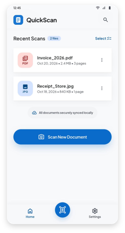
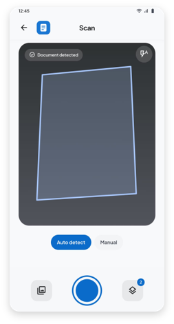
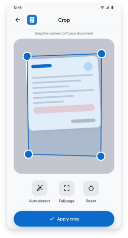
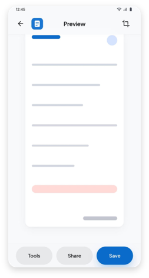
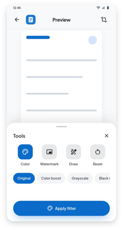
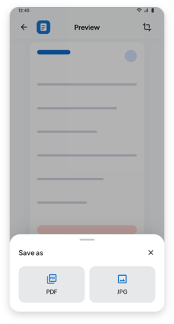
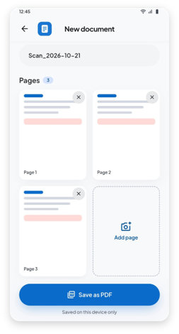
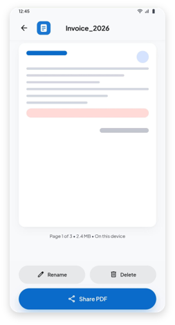
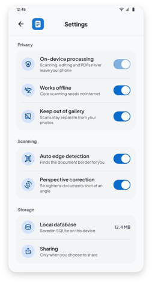

# Kameradan arşive: dokuz ekranla bir kullanıcı yolculuğu

**Kapsanan hafta:** 19–25 Ekim 2026  
**Yazar:** Bayram Külter

Bir uygulamanın ekranlarını tek tek çizmek nispeten kolaydır. Zor olan, bu ekranların **neden o sırayla geldiğini** açıklayabilmektir. Üçüncü haftada Scan App'in henüz çalışan Flutter kodu yoktu; bunun yerine kullanıcıyı ilk çekimden belge arşivine götüren bir görsel akış hazırladık.

## Ana ekranda hangi soruya cevap vermeliyiz?

Kullanıcı uygulamayı açtığında iki ihtimali var: Yeni belge taramak ya da daha önce kaydettiği belgeye dönmek. Bu yüzden ana ekranda tek bir büyük eylem butonuyla son belgeleri birlikte göstermeyi seçtik. Tarama işleminin başlangıcı belirgin olmalı; fakat var olan dosyaları bulmak da ikinci plana itilmemeli.

Kamera ekranını tasarlarken fotoğraf çekme butonunun erişilebilirliğine ve görüntünün mümkün olduğunca geniş görünmesine odaklandık. Flaş ve ek sayfa gibi işlemler ana eylemi gölgelememeli.

## Kullanıcıya kontrolü hangi noktada bırakıyoruz?

Belge taramada otomatik kenar algılama kullanışlı bir hedef; ancak kullanıcı, algoritmanın nerede hata yaptığını görebilmeli. Kırpma ekranını dört köşenin sürüklenebildiği bir düzenle tasarladık. Böylece bir sayfa eğik çekilse bile kullanıcı sınırları kendisi düzeltebilir.

Kırpma sonrasında hemen kaydetmek yerine bir önizleme adımı öngördük. Önizlemede kullanıcı, sayfayı tekrar kırpmaya dönüp dönmeyeceğine, görüntü filtresi uygulayıp uygulamayacağına veya kaydetmeye hazır olup olmadığına karar verebilir.

## Tek sayfadan belge koleksiyonuna

Bir belgenin her zaman tek fotoğraftan ibaret olmayacağını hesaba kattık. Çok sayfalı belge ekranı, sayfaların küçük önizlemelerle listelendiği; ekleme veya silme kararlarının kolayca verilebildiği bir alan olarak tasarlandı.

Belge görüntüleme ve ayarlar ekranları ise tarama işleminden sonrasını kapsıyor: Kayıtlı belgeye erişmek, adını düzenlemek, paylaşmak ve yerel saklama tercihlerini görmek.

## Dokuz tasarımın tamamı

Aşağıdaki görseller üçüncü haftada hazırlanan arayüz taslaklarıdır. **Çalışan uygulamanın ekran görüntüleri değildir.** Özellikle filtreler, çok sayfalı PDF, otomatik kenar algılama ve SQLite'ı gösteren tasarımlar, daha sonraki geliştirmeler için oluşturulmuş görsel hedeflerdir.

## Tasarımdan geliştirme sırasına

Bu çalışma yalnızca uygulamanın nasıl görüneceğini değil, **hangi ekranın hangi teknik bileşene bağlı olduğunu** da ortaya koydu. Önce Flutter iskeleti ve navigasyon; ardından kamera; daha sonra kırpma, kayıt ve PDF gibi adımların geliştirilmesi gerektiği netleşti.

Hafta ortasında hazırladığımız ilk ara rapor, açık kalan araştırmaları sıralıyordu. Hafta sonunda ekran akışlarını ve görev ayrımını netleştirerek geliştirme aşamasına hazır bir tasarım referansı oluşturduk.

## İyi tasarım yalnızca görsel tutarlılık değil

Taslaklarda aynı renklerin ve ikonların kullanılması bütünlük sağlıyor; ancak bir ekranın gerçek başarısı yanlış bir eylemi kolayca geri alabilmekle de ilgili. Kırpma ekranında “Sıfırla” seçeneğinin, fotoğraf önizlemesinde “Yeniden çek” seçeneğinin, belge kartlarında ise açık eylemlerin bulunması bu bakışın sonucu.

Dikkat ettiğimiz bir başka konu, bir sonraki adımın her ekranda belirsiz kalmamasıydı. Kullanıcı tarama sonrasında önizlemeyi, önizleme sonrasında düzenlemeyi veya kaydetmeyi bekler. Bu sıra, teknik modüllerin hazırlanacağı adımları da belirledi.

